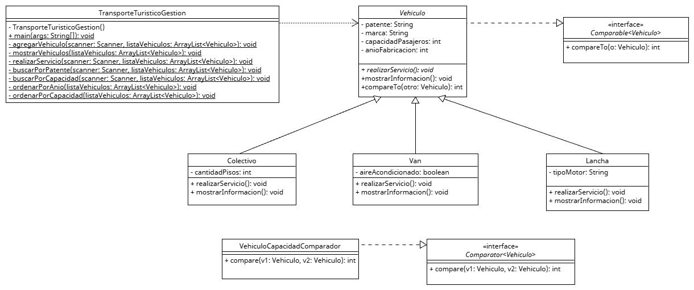

# Sistema de Gestión de Transporte Turístico

Proyecto desarrollado en Java para la materia Programación II de la Tecnicatura Universitaria en Programación — UTN.

## Descripción:

Sistema de gestión de vehículos turísticos desarrollado mediante programación orientada a objetos.

Permite administrar colectivos, vans y lanchas, registrar nuevos vehículos, consultar sus características, realizar servicios turísticos y ordenar los vehículos según distintos criterios.

La aplicación funciona mediante un menú interactivo por consola.

## Funcionalidades:

Agregar vehículos: permite registrar colectivos, vans y lanchas, con validaciones específicas para cada tipo.

Mostrar vehículos: lista todos los vehículos registrados.

Realizar servicios turísticos: permite seleccionar una excursión según el tipo de vehículo.

Buscar por patente: localiza un vehículo mediante su patente.

Filtrar por capacidad: muestra vehículos con capacidad superior a un valor ingresado.

Ordenar por año: organiza los vehículos por año de fabricación descendente.

Ordenar por capacidad: organiza los vehículos por capacidad de pasajeros descendente.

Salir: finaliza la ejecución del programa.

## Conceptos implementados:

Clases abstractas.

Herencia y polimorfismo.

Sobrescritura de métodos (@Override).

Encapsulamiento mediante atributos privados, getters y setters.

Colecciones ArrayList.

Interfaces Comparable y Comparator.

Manejo de excepciones con try, catch y throw.

Validación de datos.

Modularización mediante métodos.

Documentación JavaDoc.

## Estructura del proyecto:

## Diagrama UML:

El proyecto incluye un diagrama de clases UML donde se representan las relaciones de herencia, los atributos, los métodos principales y las implementaciones de las interfaces Comparable y Comparator.

[Descargar diagrama UML editable](docs/UML_Parcial.uxf)

## Documentacion JavaDOC

La documentación de las clases y métodos está disponible en la carpeta `docs`.
[Descargar documentación JavaDoc](docs/JavaDoc.zip)

## Recursos utilizados:

Java.

Apache NetBeans IDE.

UMLet para el diseño UML.

Git y GitHub para el control de versiones.

## Ejecución:

Clonar o descargar el repositorio.

Abrir el proyecto en Apache NetBeans.

Ejecutar la clase principal TransporteTuristicoGestion.

Interactuar con el menú desde la consola.

## Validaciones:

El sistema contempla, entre otras, las siguientes validaciones:

Patentes no vacías y sin duplicados.

Capacidad de pasajeros mayor a cero al registrar vehículos.

Año de fabricación entre 1990 y el año actual.

Colectivos de uno o dos pisos.

Lanchas con motores NAFTA, DIESEL o ELECTRICO.

Manejo de entradas no numéricas mediante excepciones.

## Documentación:

Las clases y los métodos principales están documentados mediante JavaDoc, incluyendo parámetros, valores de retorno y excepciones cuando corresponde.
